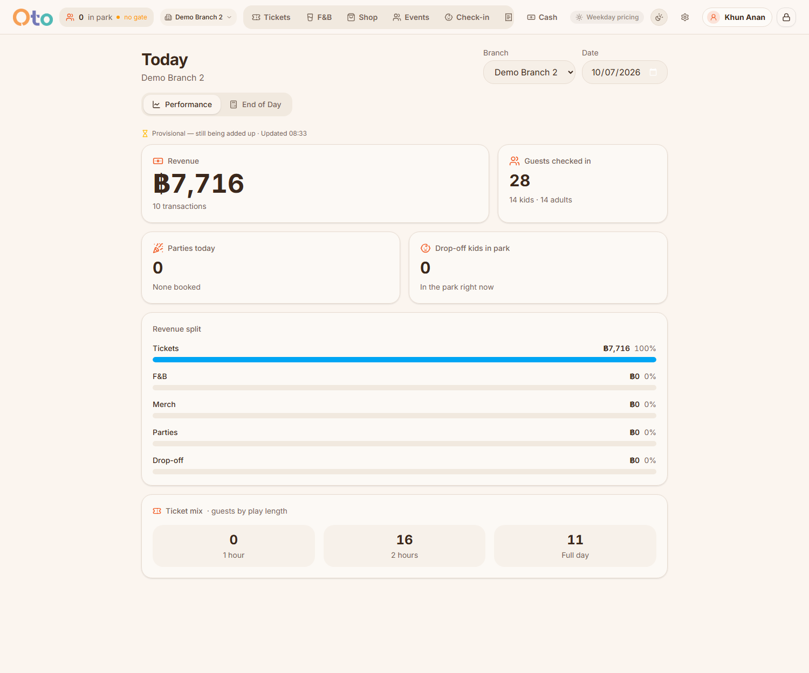
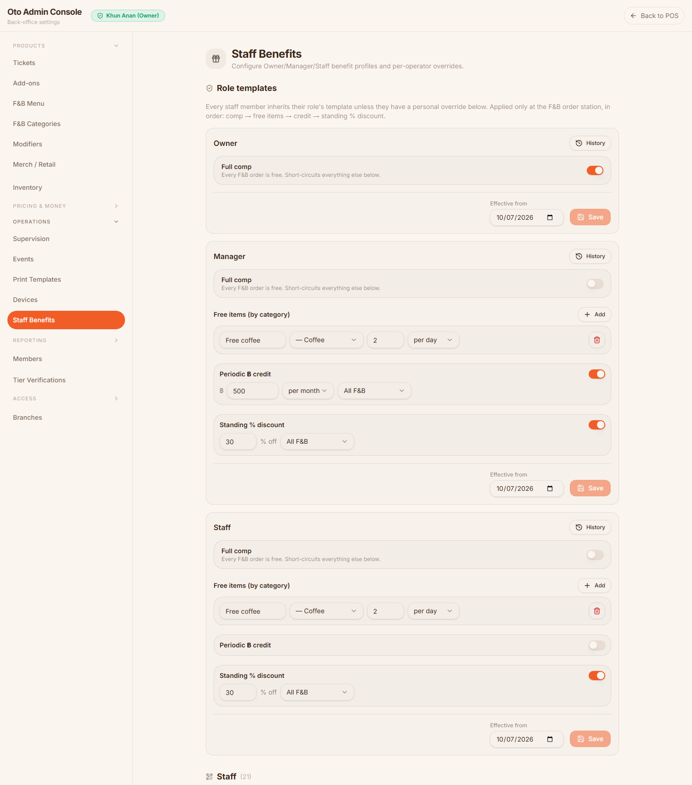
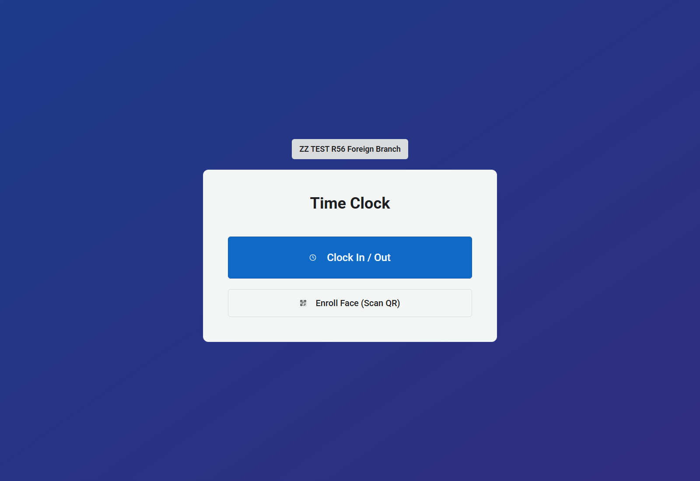
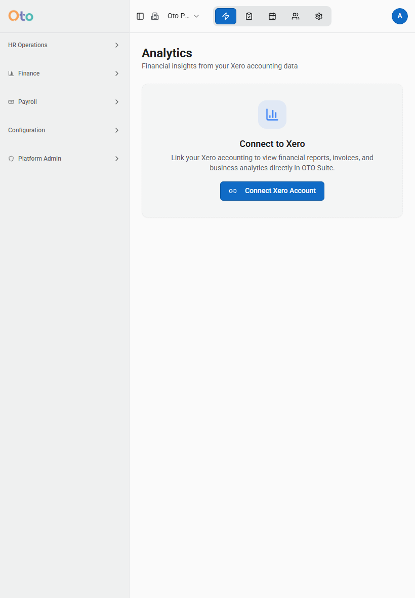

# OTO Park decisions to confirm

13 October 2026

[Presentation PDF](OWNER_CONFIRMATIONS_2026-10-13.pdf) - aligned meeting questions, clickable contents and four inspected staging illustrations.

This document gathers the remaining business choices and practical inputs recorded across the project. Each point explains the question, the current default and what an answer would change. The original plan or ticket number remains beside each question so the answer can be recorded in the right place.

**SCRUM-191 and all twelve child tickets are Deployed. The owner will move them to Done after the full and final test suite. None of these business questions blocks that final testing.** Some answers are needed before a named upcoming item can proceed. Others concern production preparation or an optional change to behavior already accepted. Keeping an accepted default does not require another approval.

Start with the questions in **Decisions for upcoming work**. The later sections provide the complete discussion list. Screenshots are existing staging captures, inspected for this document; their captions give the date and what they actually show. They are illustrations of a decision, not proof that an alternative has been built.

There are **116 discussion points, not 116 blocking decisions**. Points 1–12 are the priority queue. The remaining sections include practical information and optional changes; an accepted default can remain without a reply. Related questions are linked so one answer can cover their shared rule.

Contents: [Upcoming work, 1–12](#decisions-for-upcoming-work) · [Production, 13–19](#production-information-and-operating-arrangements) · [Future Inbox, 20–26](#future-inbox-decisions) · [Till and families, 27–43](#till-checkout-and-family-records) · [Reporting, 44–53](#reporting-choices) · [Benefits, 54–64](#staff-benefit-preferences) · [Events and kiosks, 65–72](#event-camp-and-kiosk-preferences) · [Outages and arrival, 73–85](#outage-and-arrival-operating-preferences) · [Booth inputs, 86–89](#later-booth-and-hardware-inputs) · [Staff app inputs, 90–94](#staff-app-inputs-for-future-work) · [Optional staff app changes, 95–116](#optional-staff-app-policy-changes).

To reply, quote the document number and either **keep the current default** or state the chosen alternative. Where the question asks for information, provide the person, date or example. Answers belong in the referenced plan's numbered question or SCRUM-497 for till details.

## Decisions for upcoming work

### 1 Should Today count every party payment received that day, even if the party is on another date?

**Reference:** Analytics Q3 + events Q3; SCRUM-508.

**Current default and choices:** Current default counts payments taken that day for parties held that day. Alternative: all party payments received on that date.

**Why it matters:** Determines daily party revenue and is needed for SCRUM-508. The number of parties shown is a separate calculation and does not depend on this revenue choice.

[Analytics question 3](https://github.com/vickyydev/oto-platform/blob/main/docs/progress/plans/analytics/PLAN.md#L214)

### 2 When extra play time is added to selected bands, should Drop-off/Nanny time also extend?

**Reference:** SCRUM-493 decision checkpoint, extra-time care coverage (line 35).

**Current default and choices:** Keep the supervision timer separate until answered. Alternative: extend both under an explicit rule.

**Why it matters:** Staff need to know when care is due to finish. Selected-band versus count-only is already answered: offer both.

[Source](https://github.com/vickyydev/oto-platform/blob/main/docs/qa/scrum-493-open-decisions-2026-10-06.md)

### 3 Can part of an extra-time payment be refunded while keeping the minutes, or should only a full refund cancel the extension?

**Reference:** SCRUM-493 decision checkpoint, extra-time refunds (line 35).

**Current default and choices:** No proportional reduction of minutes has been chosen. The open choice is whether a partial refund can leave all minutes intact or whether only a full refund should cancel the extension.

**Why it matters:** Determines the time entitlement after a refund.

[Source](https://github.com/vickyydev/oto-platform/blob/main/docs/qa/scrum-493-open-decisions-2026-10-06.md)

### 4 During an internet outage, should each prepaid meal be served only by its assigned food counter, or should prepaid meal serving wait for internet?

**Reference:** SCRUM-493 decision checkpoint, offline meal service (line 39).

**Current default and choices:** No exclusive-counter scheme is approved. Food and allergy information remains available offline, but independent boxes cannot confirm one shared remaining-meal balance during an outage.

**Why it matters:** Avoids serving the same prepaid meal twice and allows pickup reconciliation.

[Source](https://github.com/vickyydev/oto-platform/blob/main/docs/qa/scrum-493-open-decisions-2026-10-06.md)

### 5 When credit bought at one park is spent at another, how should the parks divide that liability in their reports?

**Reference:** SCRUM-493 decision checkpoint, cross-park credit (line 43); analytics Q10.

**Current default and choices:** Spending across parks is delivered; network totals remain coherent. Current park reports distinguish issuing-park balances and spending-park movements.

**Why it matters:** The financial ownership rule must be explicit before claiming park-level reconciliation.

[Source](https://github.com/vickyydev/oto-platform/blob/main/docs/qa/scrum-493-open-decisions-2026-10-06.md)

### 6 Should opening stock be counted once for the whole park or separately for each storage place?

**Reference:** SCRUM-485; consistency register entry 61.

**Current default and choices:** Per-place opening is the recorded implementation; first counts stay outside discrepancy totals under the recorded default.

**Why it matters:** This determines where opening quantities belong. Changing that structure later requires careful stock-history handling.

[Stock opening question](https://github.com/vickyydev/oto-platform/blob/main/docs/progress/plans/consistency/REGISTER.md#L499)

### 7 When prepaid lunch money is refunded, should its remaining spendable credit be removed, and should a refund be refused once that credit has already been spent?

**Reference:** SCRUM-481 — prepaid food refunds.

**Current default and choices:** The current owner queue records credit remaining spendable after refund. The proposed rule removes the prepaid part and refuses a refund once that credit has been spent; this proposal awaits a choice.

**Why it matters:** Keeps a refund and the remaining food balance consistent. This is separate from promotional ticket-credit clawback.

[Current owner queue](https://github.com/vickyydev/oto-platform/blob/main/docs/progress/OPEN_ITEMS.md#L134).

### 8 Should vouchers be allowed to add spendable credit without payment, who may issue them, and how should they appear in promotion reports?

**Reference:** SCRUM-482 — credit vouchers.

**Current default and choices:** The recorded till permits reception issuance. Keep this unchanged until an explicit ruling; the register proposes manager-only issuance or disabling this voucher type as alternatives.

**Why it matters:** Determines who can create promotional stored value and how the park distinguishes it from paid credit.

[Register entry59](https://github.com/vickyydev/oto-platform/blob/main/docs/progress/plans/consistency/REGISTER.md#L483).

### 9 Should staff choose/type a booth PIN, or should the system issue it?

**Reference:** SCRUM-428 — booth PIN setup.

**Current default and choices:** The typed-versus-issued ruling remains open, so existing behavior continues. Button sign-in and PIN expiry are separate delivered choices.

**Why it matters:** Determines the staff setup and replacement process.

[Current booth owner queue](https://github.com/vickyydev/oto-platform/blob/main/docs/progress/OPEN_ITEMS.md#L146).

### 10 Should the new-station setup hide payment settings for a free prize booth, or keep them for a future paid-spin booth?

**Reference:** SCRUM-434.

**Current default and choices:** The drawer currently includes cards, QR, cash and an offline wallet limit for Booth stations. No change is selected yet.

**Why it matters:** A free prize wheel does not take payment. Hiding the step simplifies setup; keeping it preserves a possible future paid-spin configuration.

[Current ticket](https://oto-suite-dev.atlassian.net/browse/SCRUM-434)

### 11 Does each branch need category-specific tax exceptions with an administration screen, or should the unused option be retired?

**Reference:** SCRUM-277.

**Current default and choices:** Retain the current till tax configuration without adding an exception rule.

**Why it matters:** A screen makes the option usable by park administrators; retiring an unused option removes ongoing support for it. Other unused groups need the same build-or-retire choice after their current usage is checked.

[Current owner queue](https://github.com/vickyydev/oto-platform/blob/main/docs/progress/OPEN_ITEMS.md#3-decisions-waiting-on-the-owner)

### 12 On a narrow phone, which till controls should move into a menu first so Lock remains reachable?

**Reference:** SCRUM-509.

**Current default and choices:** The existing phone bar keeps its controls in one row. A proposed order is to move theme and settings first while keeping Lock visible; this order needs confirmation.

**Why it matters:** Staff need quick access to locking and daily controls on small screens. Choosing the order allows the phone layout work to proceed without guessing which controls matter most.

[Current ticket](https://oto-suite-dev.atlassian.net/browse/SCRUM-509)

## Production information and operating arrangements

### 13 Meaning of older staff records' times — SCRUM-274

   **Confirm:** Were older records written in Bangkok time, UTC, or different time zones for particular imports? **Current default:** Preserve the recorded values. **Why it matters:** Converting them without this fact can move an attendance event or payroll date. A known event with its actual local time is useful evidence; the team will choose the conversion method after the meaning is confirmed.

   [Source](https://github.com/vickyydev/oto-platform/blob/main/docs/progress/OPEN_ITEMS.md#3-decisions-waiting-on-the-owner), [timestamp record](https://github.com/vickyydev/oto-platform/blob/main/docs/progress/ARCHITECTURE_CONFORMANCE_REGISTER.md#L271).

### 14 Urgent alerts and the person on call — Open decision 17

   **Confirm:** Who should receive urgent system alerts outside opening hours, and through which channel? **Current default:** Console Failures, without a confirmed external recipient in the decision record. **Why it matters:** Console-only monitoring requires somebody to look; a named email or messaging destination can reach the person expected to act. Specify a primary contact and backup, or retain Console only.

   [Source](https://github.com/vickyydev/oto-platform/blob/main/docs/progress/SPRINT_2_PLAN.md#open-decisions).

### 15 Final production data and files — production readiness

   **Confirm:** Who will supply the final exports and stored files and confirm that required history is included? **Current default:** The existing production system remains authoritative until the final import. **Why it matters:** A complete handover must include documents and photos as well as database records. First check which exports are already available; an old checklist alone does not establish that something is missing today. Access details should be supplied through the approved secure configuration process.

   [Source](https://github.com/vickyydev/oto-platform/blob/main/docs/architecture/PLATFORM_PLAN.md#L414).

### 16 Final switch date and editing pause — production readiness

   **Confirm:** Which quiet period should be reserved, when should old-system edits stop and who will be available for the switch? **Current default:** One switch after readiness, using the latest data, without a long period of both systems accepting changes. **Why it matters:** The pause lets the final import catch all changes. The one-switch approach is already agreed; only timing and responsibilities need arranging.

   [Source](https://github.com/vickyydev/oto-platform/blob/main/docs/briefs/OWNER_DIRECTION.md#L20).

### 17 Historical families in the member list — production import

   **Confirm:** Should past check-in families become member records automatically? **Recorded proposal:** Combine matching phone numbers and mark imported memberships unverified. **Why it matters:** Importing them gives reception a populated member list; starting with explicitly registered members gives a narrower list. Either choice can retain historical visits. This asks about membership creation, not permission to discard history.

   [Source](https://github.com/vickyydev/oto-platform/blob/main/docs/architecture/PLATFORM_PLAN.md#L447).

### 18 Marketing Hub and Omni connection — production integration

   **Confirm:** Which tool uses the Radar summary feed, who maintains it and is the connection still needed? **Current default:** Preserve existing integration behavior until the consumer is identified. **Why it matters:** Knowing the receiving system and its owner allows the existing feed to continue at the switch. No credential values are needed in this document.

   [Source](https://github.com/vickyydev/oto-platform/blob/main/docs/architecture/PLATFORM_PLAN.md#L443).

### 19 How long records and photos are kept — Open decisions 12 and 33

   **Confirm:** What retention periods should apply to child photos, conversations and operational records, and who approves the final schedule? **Current default:** Synthetic photos on staging and no general purge this sprint. **Why it matters:** Financial history, child-release records and ordinary media have different purposes. The care plan records 30 days after release for its stored visit photo; the separate box-copy proposal is seven days. These are different storage locations, not one universal period. Record the chosen periods by category before enabling real-data deletion.

   [Source](https://github.com/vickyydev/oto-platform/blob/main/docs/progress/SPRINT_2_PLAN.md#open-decisions).

## Future Inbox decisions

These concern the later Inbox story. The latest in-app IT Brief remains the default. The delivered staff notification inbox under SCRUM-191 is separate.

### 20 Status flow and who handles birthday enquiries

   **Confirm:** Keep the latest brief's two statuses, three tabs, fixed backup pairs and Divert action? Name the primary and backup staff for English and Russian birthday enquiries. **Current default:** The latest brief. **Why it matters:** Two older briefs reverse the language assignments. Confirming named responsibilities prevents enquiries being routed to a different person than intended.

### 21 Customer language

   **Confirm:** Should customers choose English, Russian or Thai, or should Inbox detect their language? **Current default:** Automatic detection. **Why it matters:** A chooser gives customers explicit control but adds a prompt; detection avoids that step and needs an easy handoff when the language is uncertain.

### 22 Channels and reception numbers

   **Confirm:** Which channels launch first, which WhatsApp or reception numbers belong to each branch, and should staff use named accounts on shared phones? **Current default:** The latest brief; Telegram is a contact field without a connected adapter. **Why it matters:** Channel ownership determines setup and routing. Name the account owner and secure connection process. LINE messaging does not, by itself, authorize a visitor self-registration feature.

### 23 Booking dates and final event orders

   **Confirm:** Which calendar should reserve a birthday date from Inbox, and where should the final event order be saved? **Current default:** Existing online events use the OTO App as their record source. **Why it matters:** The future Book Date handoff needs one authoritative booking so two channels do not make independent reservations. This does not reopen the delivered event reads.

### 24 AI replies and operating budget

   **Confirm:** May AI send general replies directly, who maintains its answers, and what translation or transcription budget applies? **Current default:** The latest brief allows general answers and hands birthday sales and named cases to people. **Why it matters:** The chosen approval level determines response speed and staff responsibility; the budget and information owner make live operation manageable. This is separate from delivered Ask OTO.

### 25 Phone use and reply-time targets

   **Confirm:** Should staff receive phone notifications and reply on phones, and what reply-time target applies during opening hours? **Current default:** Desktop-first and the existing average-response dashboard. **Why it matters:** Phone support affects the working interface; a target needs named recipients for overdue alerts. Coordinate those recipients with the urgent-alert decision above.

### 26 Conversation import and marketing follow-ups

   **Confirm:** Which earlier conversations should be imported, what permission covers marketing follow-ups, and should the dashboard keep its three metrics or use the six-metric reference? **Current default:** No extra marketing behavior or retention rule is introduced. **Why it matters:** These choices determine the initial Inbox workload, allowed follow-up use and reporting layout. Apply the category-specific retention answer above to conversation media as well.

   [Source for the seven Inbox questions](https://github.com/vickyydev/oto-platform/blob/main/docs/features/inbox.md#L445), [standing brief decision](https://github.com/vickyydev/oto-platform/blob/main/docs/progress/SPRINT_2_PLAN.md#open-decisions).

## Till checkout and family records

These are recorded choices for their module. Existing behavior remains the default unless a change is requested; they do not reopen the delivered lift scope.

### 27 Can a ticket-only promotion reduce socks or lockers after the ticket amount has already been discounted away?

**Reference:** SCRUM-497, consistency register entry 44.

**Current default and choices:** Recorded platform confines it to its own remaining ticket amount; the original calculation only capped at the whole bill. Confirm the scope-only limit or the original whole-bill calculation.

**Why it matters:** Changes the final amount when overlapping promotions are stacked. No currently held code was scoped this way in the recorded census.

[Consistency register source](https://github.com/vickyydev/oto-platform/blob/main/docs/progress/plans/consistency/REGISTER.md#L363)

### 28 If a ticket has no price for a newly added customer tier, should it be unavailable or cost zero?

**Reference:** SCRUM-497, consistency register entry 45.

**Current default and choices:** Recorded platform refuses sale; original design shows zero.

**Why it matters:** Prevents unintended free sales or permits deliberate free tiers.

[Consistency register source](https://github.com/vickyydev/oto-platform/blob/main/docs/progress/plans/consistency/REGISTER.md#L371)

### 29 Do price days, promotion dates and daily staff benefits reset at midnight or at the park’s 05:00 trading-day boundary?

**Reference:** SCRUM-497, consistency register entry 46.

**Current default and choices:** Recorded platform uses 05:00; original pricing uses calendar midnight. Benefits Q6 links to this same answer.

**Why it matters:** Affects activity between midnight and 05:00. Ask once across modules.

[Consistency register source](https://github.com/vickyydev/oto-platform/blob/main/docs/progress/plans/consistency/REGISTER.md#L379)

### 30 Who may permanently remove a member’s verified rate: reception or a manager?

**Reference:** SCRUM-497, consistency register entry 47.

**Current default and choices:** Recorded removal needs a manager. Selling a verified member at the ordinary rate is already delivered separately.

**Why it matters:** Distinguishes a one-sale choice from changing the saved membership.

[Consistency register source](https://github.com/vickyydev/oto-platform/blob/main/docs/progress/plans/consistency/REGISTER.md#L387)

### 31 May managers correct or remove a holiday pricing range after it has been used?

**Reference:** SCRUM-497, consistency register entry 48.

**Current default and choices:** Recorded platform freezes dates/removal; alternative permits edits while past sales keep their saved values.

**Why it matters:** Lets the park correct future use without rewriting past receipts.

[Consistency register source](https://github.com/vickyydev/oto-platform/blob/main/docs/progress/plans/consistency/REGISTER.md#L395)

### 32 May reception refund a sale directly, or must a manager approve?

**Reference:** SCRUM-497, consistency register entry 49.

**Current default and choices:** Recorded gate requires a manager; original design allows a signed-in cashier. A manager co-sign would be a separate specified flow.

**Why it matters:** Determines whether the desk can help a family immediately.

[Consistency register source](https://github.com/vickyydev/oto-platform/blob/main/docs/progress/plans/consistency/REGISTER.md#L403)

### 33 After a card payment can no longer be voided, should the family receive cash or a refund to the card where the terminal supports it?

**Reference:** SCRUM-497, consistency register entry 50.

**Current default and choices:** Cash is the recorded current fallback and earlier recommendation. Card return is the alternative, subject to actual terminal capabilities.

**Why it matters:** Affects cash drawer reconciliation and the family's wait for funds. The available choices depend on the payment provider confirming what the park's terminal supports.

[Consistency register source](https://github.com/vickyydev/oto-platform/blob/main/docs/progress/plans/consistency/REGISTER.md#L411)

### 34 Can the same item be selected for a second partial refund?

**Reference:** SCRUM-497, consistency register entry 51.

**Current default and choices:** Recorded platform removes already-covered items; Amount remains available. Original design permits repeated selection within the remaining refundable amount.

**Why it matters:** Repeat adjustments on a partially refunded line.

[Consistency register source](https://github.com/vickyydev/oto-platform/blob/main/docs/progress/plans/consistency/REGISTER.md#L419)

### 35 On a zero-baht ticket sale, should staff still select a payment method?

**Reference:** SCRUM-497, consistency register entry 52.

**Current default and choices:** Recorded platform offers Complete Sale without a tender; original ticket flow asks for a tender.

**Why it matters:** Receipt/report classification and one fewer desk step. F&B’s zero-total flow is already part of the original design.

[Consistency register source](https://github.com/vickyydev/oto-platform/blob/main/docs/progress/plans/consistency/REGISTER.md#L427)

### 36 On the POS booking website, should a verified returning parent see saved children and save their contact preference?

**Reference:** SCRUM-497, consistency register entry 53.

**Current default and choices:** Original-design default: restore this behind a one-time SMS check; the older arrival plan kept children hidden without verification.

**Why it matters:** Less repeat typing while protecting family information. **This is POS `/book` / SCRUM-357, not the OTO App camp SMS feature delivered under SCRUM-522.**

[Consistency register source](https://github.com/vickyydev/oto-platform/blob/main/docs/progress/plans/consistency/REGISTER.md#L435)

### 37 If tax settings change after a family pays online, should reception still issue their bands using the booking’s paid total and saved tax basis?

**Reference:** SCRUM-497, consistency register entry 54.

**Current default and choices:** Recorded platform refuses on a total difference. Proposed alternative keeps the paid basis and flags the difference.

**Why it matters:** Avoids holding up a paid family at arrival.

[Consistency register source](https://github.com/vickyydev/oto-platform/blob/main/docs/progress/plans/consistency/REGISTER.md#L443)

### 38 Is booking up to 60 days ahead the desired limit?

**Reference:** SCRUM-497, consistency register entry 55.

**Current default and choices:** Recorded platform: today through 60 days. Alternative: another limit or a branch setting.

**Why it matters:** How far ahead families may plan.

[Consistency register source](https://github.com/vickyydev/oto-platform/blob/main/docs/progress/plans/consistency/REGISTER.md#L451)

### 39 Should a drop-off walk-in automatically get a saved member profile?

**Reference:** SCRUM-497, consistency register entry 56.

**Current default and choices:** Recorded platform creates one from the parent’s phone; original design only saves to an existing member.

**Why it matters:** Returning-family convenience and which families enter the member records.

[Consistency register source](https://github.com/vickyydev/oto-platform/blob/main/docs/progress/plans/consistency/REGISTER.md#L459)

### 40 Should staff be able to remove someone from today’s authorised pickup list?

**Reference:** SCRUM-497, consistency register entry 57.

**Current default and choices:** Recorded platform has Take off the pickup list; original design only adds/edits.

**Why it matters:** Controls who can collect the child after plans change.

[Consistency register source](https://github.com/vickyydev/oto-platform/blob/main/docs/progress/plans/consistency/REGISTER.md#L467)

### 41 Should an edit on today’s child-care board also update that child’s saved profile for future visits?

**Reference:** SCRUM-497, consistency register entry 58.

**Current default and choices:** Recorded platform updates both; original design changes only the stay.

**Why it matters:** Whether an allergy/name correction persists to the next visit.

[Consistency register source](https://github.com/vickyydev/oto-platform/blob/main/docs/progress/plans/consistency/REGISTER.md#L475)

### 42 If one flavour or size is sold out, may the remaining ones still be sold?

**Reference:** SCRUM-497, consistency register entry 62.

**Current default and choices:** Recorded platform keeps the tile available with Low; original design marks the whole tile Out.

**Why it matters:** Whether stock in other variants remains available for sale. The current stock narrowing does not specifically settle this F&B display choice.

[Consistency register source](https://github.com/vickyydev/oto-platform/blob/main/docs/progress/plans/consistency/REGISTER.md#L507)

### 43 May parents add or remove saved children on the customer display, and should the age limit match the till’s 12 years?

**Reference:** SCRUM-497, consistency register entry 65.

**Current default and choices:** Original-design default permits the parent’s changes and caps at 12; recorded paired display asks staff for new/removal actions and permits up to 17.

**Why it matters:** Parent independence and one consistent age range.

[Consistency register source](https://github.com/vickyydev/oto-platform/blob/main/docs/progress/plans/consistency/REGISTER.md#L531)

## Reporting choices

*Today revenue categories on staging, captured 7 October 2026. The screen shows provisional figures and the five revenue categories; it does not establish which party-payment date the owner prefers.*

These are recorded choices for their module. Existing behavior remains the default unless a change is requested; they do not reopen the delivered lift scope.

### 44 Should a reporting day begin at 05:00 Bangkok time?

**Reference:** Analytics plan Q1.

**Current default and choices:** Branch business date, 05:00; choose another branch start if needed.

**Why it matters:** Keeps late trading with the same day's cash-up. Point 29 asks whether pricing and benefit resets should use this same boundary; the reporting boundary can remain unchanged even if those rules differ.

[Analytics plan source](https://github.com/vickyydev/oto-platform/blob/main/docs/progress/plans/analytics/PLAN.md#L207)

### 45 Keep camp and event passes under Tickets, or give them a separate revenue bar?

**Reference:** Analytics plan Q2.

**Current default and choices:** Tickets; five bars remain. Only the care service appears under Drop-off.

**Why it matters:** Readable category comparisons. Links events Q2.

[Analytics plan source](https://github.com/vickyydev/oto-platform/blob/main/docs/progress/plans/analytics/PLAN.md#L210)

### 46 Should a later refund reduce the original sale day or the day the refund was paid?

**Reference:** Analytics plan Q4.

**Current default and choices:** Original sale day, even after that day was closed; the closed cash-up record stays frozen.

**Why it matters:** Historical revenue versus daily money movement.

[Analytics plan source](https://github.com/vickyydev/oto-platform/blob/main/docs/progress/plans/analytics/PLAN.md#L216)

### 47 Should revenue include VAT and service charge?

**Reference:** Analytics plan Q5.

**Current default and choices:** Gross inclusive figure; alternative net revenue.

**Why it matters:** Keeps reports comparable. This asks about the platform's revenue presentation; the accepted legacy Radar formulas remain unchanged.

[Analytics plan source](https://github.com/vickyydev/oto-platform/blob/main/docs/progress/plans/analytics/PLAN.md#L218)

### 48 Keep ticket credit counted when sold, with spending excluded and no extra revenue change when it expires?

**Reference:** Analytics plan Q6.

**Current default and choices:** Yes. Alternative needs an explicit expiry accounting rule.

**Why it matters:** Avoids counting the same money twice.

[Analytics plan source](https://github.com/vickyydev/oto-platform/blob/main/docs/progress/plans/analytics/PLAN.md#L219)

### 49 Show today’s figures while they are still being added up, or show completed days only?

**Reference:** Analytics plan Q8.

**Current default and choices:** Show today with Provisional label.

**Why it matters:** Staff can see current activity before totals are complete. The reporting screenshot above illustrates the Provisional label.

[Analytics plan source](https://github.com/vickyydev/oto-platform/blob/main/docs/progress/plans/analytics/PLAN.md#L226)

### 50 Keep one-branch Performance available to users who can open Today, and limit All branches to their permitted branches?

**Reference:** Analytics plan Q9.

**Current default and choices:** Yes.

**Why it matters:** Which managers/staff see cross-branch figures.

[Analytics plan source](https://github.com/vickyydev/oto-platform/blob/main/docs/progress/plans/analytics/PLAN.md#L228)

### 51 Show booth totals beside the voucher counts staff type at End of Day?

**Reference:** Analytics plan Q11.

**Current default and choices:** Current manual entry remains; comparison would be an addition.

**Why it matters:** Helps staff compare their count without replacing it.

[Analytics plan source](https://github.com/vickyydev/oto-platform/blob/main/docs/progress/plans/analytics/PLAN.md#L232)

### 52 In Ticket type sales, should care fees and food remain on the separate care card?

**Reference:** Analytics plan Q15.

**Current default and choices:** Yes; ticket row contains ticket price only. Alternative includes care fee/food in the ticket row too.

**Why it matters:** Prevents comparing unlike ticket values.

[Analytics plan source](https://github.com/vickyydev/oto-platform/blob/main/docs/progress/plans/analytics/PLAN.md#L244)

### 53 Keep earlier demo sales visible in the original park’s reports, or mark them out of totals while retaining their records?

**Reference:** Analytics plan Q16.

**Current default and choices:** Keep them.

**Why it matters:** Clean operational reporting without deleting recorded sales.

[Analytics plan source](https://github.com/vickyydev/oto-platform/blob/main/docs/progress/plans/analytics/PLAN.md#L252)

## Staff benefit preferences

*Staff benefit settings on staging, captured 7 October 2026. This shows the role amounts and reset periods for discussion, not today's balances. No benefit QR is shown.*

These are recorded choices for their module. Existing behavior remains the default unless a change is requested; they do not reopen the delivered lift scope.

### 54 Should a personal benefit override replace the person’s whole role package, or only the fields changed?

**Reference:** Benefits plan Q1.

**Current default and choices:** Whole package. A partial override would inherit unspecified benefits.

**Why it matters:** Determines whether changing one allowance also replaces the person's other role benefits.

[Benefits plan source](https://github.com/vickyydev/oto-platform/blob/main/docs/progress/plans/benefits/PLAN.md#L321)

### 55 Confirm the actual benefit amounts for each role.

**Reference:** Benefits plan Q2.

**Current default and choices:** Owner: full comp; Manager: 2 coffees/day, ฿500/month, 30% F&B; Staff: 2 coffees/day, 30% F&B. Values are editable. The benefit-settings screenshot above illustrates these recorded amounts.

[Benefits plan source](https://github.com/vickyydev/oto-platform/blob/main/docs/progress/plans/benefits/PLAN.md#L325)

### 56 Does applying a full comp need separate approval?

**Reference:** Benefits plan Q3.

**Current default and choices:** Recorded activity is enough under the existing rule; extra approval is the alternative.

**Why it matters:** An additional approval adds a second step before the order can be completed.

[Benefits plan source](https://github.com/vickyydev/oto-platform/blob/main/docs/progress/plans/benefits/PLAN.md#L331)

### 57 When a benefited order is refunded, should used coffee/credit allowances return?

**Reference:** Benefits plan Q4.

**Current default and choices:** They stay used. Returning allowances would permit reuse within the period.

**Why it matters:** Determines the person's remaining entitlement after a refunded order.

[Benefits plan source](https://github.com/vickyydev/oto-platform/blob/main/docs/progress/plans/benefits/PLAN.md#L334)

### 58 Keep staff benefits at F&B only, or also accept them at the ticket till?

**Reference:** Benefits plan Q5.

**Current default and choices:** F&B only. Defines where a benefit can be spent.

[Benefits plan source](https://github.com/vickyydev/oto-platform/blob/main/docs/progress/plans/benefits/PLAN.md#L337)

### 59 Round benefit discounts to whole baht or satang?

**Reference:** Benefits plan Q8.

**Current default and choices:** Whole baht, matching the current manual percentage discount rule.

**Why it matters:** Determines the final discount and receipt total where the calculation contains fractions of a baht.

[Benefits plan source](https://github.com/vickyydev/oto-platform/blob/main/docs/progress/plans/benefits/PLAN.md#L349)

### 60 May the cashier apply their own benefit card?

**Reference:** Benefits plan Q9.

**Current default and choices:** Yes; both identities are recorded. Extra approval or another cashier would be a new rule.

**Why it matters:** Determines whether a staff purchase needs another employee available to complete it.

[Benefits plan source](https://github.com/vickyydev/oto-platform/blob/main/docs/progress/plans/benefits/PLAN.md#L352)

### 61 Is one Staff benefit line in Discounts & Comps enough, or should it split free items, credit, comp and percentage discount?

**Reference:** Benefits plan Q10.

**Current default and choices:** One line; detailed data already exists in the benefits report. This is a display choice.

[Benefits plan source](https://github.com/vickyydev/oto-platform/blob/main/docs/progress/plans/benefits/PLAN.md#L355)

### 62 Keep staff benefits after the bill’s manual discounts and before promotion codes?

**Reference:** Benefits plan Q11.

**Current default and choices:** Yes. Changing the order can change the benefit and total.

[Benefits plan source](https://github.com/vickyydev/oto-platform/blob/main/docs/progress/plans/benefits/PLAN.md#L360)

### 63 If a benefit card is refused, should the customer screen show the staff name?

**Reference:** Benefits plan Q12.

**Current default and choices:** Existing wording names the person. Alternative: a plain refusal for guests, name on staff screen only.

**Why it matters:** Determines which staff details nearby guests can see during a refused benefit attempt.

[Benefits plan source](https://github.com/vickyydev/oto-platform/blob/main/docs/progress/plans/benefits/PLAN.md#L363)

### 64 Should manually typed benefit-like reasons using lookalike letters be refused?

**Reference:** Benefits plan Q13.

**Current default and choices:** They remain ordinary recorded manual-discount reasons and grant no extra rights. Refusing similar-looking text would make discount descriptions more consistent without changing benefit permissions.

[Benefits plan source](https://github.com/vickyydev/oto-platform/blob/main/docs/progress/plans/benefits/PLAN.md#L370)

## Event camp and kiosk preferences

These are recorded choices for their module. Existing behavior remains the default unless a change is requested; they do not reopen the delivered lift scope.

### 65 Should party add-ons stay on the party bill only, or create ordinary sales, kitchen tickets, stock movements and bands?

**Reference:** Events and kiosk plan Q3.

**Current default and choices:** Party ledger only. Creating ordinary sales would also trigger their operational effects. Point 1 covers when party payments appear in daily revenue; this point covers how the add-ons are fulfilled.

[Events and kiosk plan source](https://github.com/vickyydev/oto-platform/blob/main/docs/progress/plans/events-kiosk/PLAN.md#L386)

### 66 When a walk-up joins the remaining camp days, charge once or at each day’s check-in?

**Reference:** Events and kiosk plan Q5.

**Current default and choices:** Pay one day’s price once and register from today to the end. Per-day payment changes how the desk collects money.

[Events and kiosk plan source](https://github.com/vickyydev/oto-platform/blob/main/docs/progress/plans/events-kiosk/PLAN.md#L395)

### 67 Keep the generic walk-up camp/event prices for reference, while pass sales use each event’s own price and party extras use the party-guest price?

**Reference:** Events and kiosk plan Q8.

**Current default and choices:** Yes. Pass sales use each event's price and party extras use the party-guest price. A different role for the generic prices would be an optional new pricing flow.

[Events and kiosk plan source](https://github.com/vickyydev/oto-platform/blob/main/docs/progress/plans/events-kiosk/PLAN.md#L412)

### 68 Is 60 seconds without a touch or scan the right kiosk reset time?

**Reference:** Events and kiosk plan Q9.

**Current default and choices:** 60 seconds returns to the welcome screen and records abandonment. Longer gives families more time; shorter clears their screen sooner.

[Events and kiosk plan source](https://github.com/vickyydev/oto-platform/blob/main/docs/progress/plans/events-kiosk/PLAN.md#L415)

### 69 Treat birthdays, private events and school groups as parties; camps as camps; the other types as events?

**Reference:** Events and kiosk plan Q10.

**Current default and choices:** This mapping is delivered and remains accepted. A different classification would change which billing flow applies.

[Events and kiosk plan source](https://github.com/vickyydev/oto-platform/blob/main/docs/progress/plans/events-kiosk/PLAN.md#L418)

### 70 Should cancelled camps/events still offer pass cards at the till and booking site?

**Reference:** Events and kiosk plan Q12.

**Current default and choices:** Existing cards remain visible until answered. Hiding them would stop new pass sales for cancelled events.

[Events and kiosk plan source](https://github.com/vickyydev/oto-platform/blob/main/docs/progress/plans/events-kiosk/PLAN.md#L426)

### 71 Should text such as “None” in an allergy field still trigger the red allergy badge?

**Reference:** Events and kiosk plan Q13.

**Current default and choices:** Any non-empty text triggers it. Alternative needs an agreed list/rule; diet words may also be present.

[Events and kiosk plan source](https://github.com/vickyydev/oto-platform/blob/main/docs/progress/plans/events-kiosk/PLAN.md#L431)

### 72 Keep other-park, cancelled or expired bookings on this park’s kiosk help desk list, or move them out after staff review/end of day?

**Reference:** Events and kiosk plan Q14.

**Current default and choices:** Listed for staff help. Wording and an end-of-day sweep are still a choice.

[Events and kiosk plan source](https://github.com/vickyydev/oto-platform/blob/main/docs/progress/plans/events-kiosk/PLAN.md#L437)

## Outage and arrival operating preferences

These are recorded choices for their module. Existing behavior remains the default unless a change is requested; they do not reopen the delivered lift scope.

### 73 Unlock an offline till with the existing password or a short station PIN?

**Reference:** Offline plan OD2.

**Current default and choices:** Password. A PIN is an optional change, separate from booth PIN policy.

[Source](https://github.com/vickyydev/oto-platform/blob/main/docs/progress/plans/offline/PLAN.md#L191)

### 74 If an offline card terminal took payment but the till got no answer, may staff record the terminal’s approval code?

**Reference:** Offline plan OD3.

**Current default and choices:** Proposed recorded confirmation for reconciliation; actual terminal screen must support it. This is distinct from confirming no money was taken.

[Source](https://github.com/vickyydev/oto-platform/blob/main/docs/progress/plans/offline/PLAN.md#L196)

### 75 Are a warning after 24 hours without a price update and stopping new sales after 7 days acceptable?

**Reference:** Offline plan OD5.

**Current default and choices:** Those two cache ages are the current proposed settings. Determines outage tolerance versus stale prices.

[Source](https://github.com/vickyydev/oto-platform/blob/main/docs/progress/plans/offline/PLAN.md#L218)

### 76 Allow offline sign-in for staff seen on that box in the past 30 days if the dismissal list is less than 72 hours old?

**Reference:** Offline plan OD6.

**Current default and choices:** Yes under the recorded bounds. Controls who can work during an outage.

[Source](https://github.com/vickyydev/oto-platform/blob/main/docs/progress/plans/offline/PLAN.md#L226)

### 77 Should discounts, comps or tier changes need a second person while offline?

**Reference:** Offline plan OD11.

**Current default and choices:** Same permissions as online, no new second-person step; refunds/voids remain refused offline.

[Source](https://github.com/vickyydev/oto-platform/blob/main/docs/progress/plans/offline/PLAN.md#L255)

### 78 Confirm offline spending cap and wallet expiry.

**Reference:** Wallet plan OD-W1. Also offline plan OD14.

**Current default and choices:** The wallet plan records ฿300 per wallet/day, same-day expiry and refund of unused prepaid value as configurable policy. Point 7 separately covers a refund after credit has been spent; point 80 covers promotional ticket credit. These balances need distinct rules.

[Source](https://github.com/vickyydev/oto-platform/blob/main/docs/progress/plans/wallet/PLAN.md#L169)

### 79 Should ticket credit be based on list price before discounts?

**Reference:** Wallet plan OD-W2.

**Current default and choices:** Yes. Discounting the ticket does not reduce its credit grant.

[Source](https://github.com/vickyydev/oto-platform/blob/main/docs/progress/plans/wallet/PLAN.md#L173)

### 80 Should refunding a ticket remove the promotional credit it granted?

**Reference:** Wallet plan OD-W4.

**Current default and choices:** Promotional credit stays under the original rule. Removing it would require a changed refund rule. This differs from prepaid-food credit in point 7, where the family paid for the credit itself.

[Source](https://github.com/vickyydev/oto-platform/blob/main/docs/progress/plans/wallet/PLAN.md#L179)

### 81 Keep the platform nanny roster, or feed it from the OTO App schedule?

**Reference:** Checkin plan OD-C4.

**Current default and choices:** Seeded platform roster now; future schedule feed is a separate requested integration.

[Source](https://github.com/vickyydev/oto-platform/blob/main/docs/progress/plans/checkin/PLAN.md#L181)

### 82 During an outage, should a newly printed band unknown to the gate send the guest to reception?

**Reference:** Arrival plan OD-A5.

**Current default and choices:** Yes. Online the box asks the platform first.

[Source](https://github.com/vickyydev/oto-platform/blob/main/docs/progress/plans/arrival/PLAN.md#L164)

### 83 Accept that the same booking redeemed at two offline boxes is discovered on reconnect?

**Reference:** Arrival plan OD-A9.

**Current default and choices:** Yes, per existing offline limitation; same-box tills share one log. This is an operating limitation requiring awareness, not a promise of offline global single-use.

[Source](https://github.com/vickyydev/oto-platform/blob/main/docs/progress/plans/arrival/PLAN.md#L184)

### 84 Confirm the unpaid booking timeout and allow a late successful payment to confirm with an alert?

**Reference:** Arrival plan OD-A11.

**Current default and choices:** Configured payment window, late payment still confirms because no capacity limit is in use.

[Source](https://github.com/vickyydev/oto-platform/blob/main/docs/progress/plans/arrival/PLAN.md#L194)

### 85 Is inferred gate health sufficient where the controller does not send its display’s fault code?

**Reference:** Arrival plan OD-A13.

**Current default and choices:** Yes; Health reports the faults it can observe. Showing the controller's own display code depends on the supplier exposing it through the connection.

[Source](https://github.com/vickyydev/oto-platform/blob/main/docs/progress/plans/arrival/PLAN.md#L206)

## Later booth and hardware inputs

These are recorded choices for their module. Existing behavior remains the default unless a change is requested; they do not reopen the delivered lift scope.

### 86 How should a free-product voucher be honoured at a different park?

**Reference:** Booth closing review Q7; SCRUM-405.

**Current default and choices:** The voucher uses its linked product at the selling park. Cross-park choices are a matching product name at redemption or an explicit product link per park. The existing configuration workaround remains available while the preferred process is chosen.

[Source](https://github.com/vickyydev/oto-platform/blob/main/docs/progress/plans/booth/AUDIT-CLOSING-2026-09-25.md#L1286)

### 87 May a staff manual discount or member-tier price be used with a booth voucher?

**Reference:** Booth closing review Q8.

**Current default and choices:** Manual discounts currently coexist; member-tier pricing remains a separate open choice in booth plan decision 7. Other voucher/promotion combinations remain excluded under the accepted rule.

[Source](https://github.com/vickyydev/oto-platform/blob/main/docs/progress/plans/booth/AUDIT-CLOSING-2026-09-25.md#L1292)

### 88 Should changing a voucher’s value affect slips already printed?

**Reference:** Booth closing review Q11.

**Current default and choices:** Yes immediately. Alternative freezes printed amount/percentage; previously unlinked free-product/1+1 slips still need their product link.

[Source](https://github.com/vickyydev/oto-platform/blob/main/docs/progress/plans/booth/AUDIT-CLOSING-2026-09-25.md#L1310)

### 89 Supply the published legacy voucher data and identify the static-QR switch date/campaign windows.

**Reference:** SCRUM-426; booth plan legacy voucher import.

**Current default and choices:** Legacy short codes remain unavailable until the published campaign data can be imported. The actual codes and campaign windows need a secure handover to support existing printed vouchers.

[Source](https://github.com/vickyydev/oto-platform/blob/main/docs/progress/plans/booth/PLAN.md)

## Staff app inputs for future work

### 90 Branch choice when granting app access — Q7 / SCRUM-469

**Ask:** Should administrators select branches when granting OTO App access? **Today:** Platform provisioning grants all branches. The branch picker remains held for the owner's go. **Why and what changes:** A picker would retain the selected branches instead. This is future access-management work; scheduling's park-group protection is already delivered.

[Source](https://github.com/vickyydev/oto-platform/blob/main/docs/progress/plans/otoapp-lift/PLAN.md#L1729).

### 91 Production face clock-in — Q9

*13 October staging capture. The enrollment entry is visible, while face use remains disabled by the standing setting. This image does not demonstrate successful face enrollment or an attendance attachment.*

**Ask:** Keep face clock-in off in production, or schedule activation and face re-enrollment? **Today:** Off is the standing decision; PIN and phone alternatives remain. **Why and what changes:** Activation needs configuration, re-enrollment and controlled positive verification. Optional attendance evidence is built, but its face-enabled staging upload was not demonstrated. Do not enable face merely to obtain evidence.

[Source](https://github.com/vickyydev/oto-platform/blob/main/docs/progress/plans/otoapp-lift/PLAN.md#L1737).

### 92 Older directory connections — Q13

**Ask:** Does an outside service still use the older shared HR directory connection, and who maintains it? **Today:** Where configured, it serves the default park group only; staging leaves it unset. **Why and what changes:** A caller inventory determines compatibility and migration planning. No retirement decision or secret/key value is requested.

[Source](https://github.com/vickyydev/oto-platform/blob/main/docs/progress/plans/otoapp-lift/PLAN.md#L1751).

### 93 Xero test organisation — Q15

*13 October staging capture. The app offers Connect Xero Account; no successful exchange or populated accounting report is claimed.*

**Ask:** Which test organisation and responsible administrator should complete the controlled Xero connection and report check? **Today:** Synchronization is manual. Recorded staging evidence shows the unconnected state; positive sandbox exchange remains unavailable. **Why and what changes:** Providing the organisation and operator enables real integration verification. This does not authorize a schedule or change completed feature scope.

[Source](https://github.com/vickyydev/oto-platform/blob/main/docs/progress/plans/otoapp-lift/PLAN.md#L1757), [staging limit](https://github.com/vickyydev/oto-platform/blob/main/docs/qa/oto-app-lift/round-7/xero.md#L3).

### 94 Repeated profit-report lines — Q55

**Ask:** Can separate report lines share the same section, name and location? Please provide an example or the source field distinguishing them. **Today:** Every returned cell is retained in a fresh snapshot. **Why and what changes:** A reliable source identity could support another duplicate safeguard. Display labels alone must not merge distinct lines. Existing finance keys and atomic imports are delivered.

[Source](https://github.com/vickyydev/oto-platform/blob/main/docs/progress/plans/otoapp-lift/PLAN.md#L2185).

## Optional staff app policy changes

These are available future policy choices, not outstanding release approvals. If no change is requested, keep the current behavior.

### 95 Leave approval stages — Q1

**Ask:** Should leave have a separate pending, approved or rejected process? **Today:** Leave counts as approved; sick-day actions retain existing shift handling. No separate leave approval status is stored. **Why and what changes:** A stored workflow adds stages, approver/time and rejection rules. Delivered employee review/history approval is separate and remains complete.

[Source](https://github.com/vickyydev/oto-platform/blob/main/docs/progress/plans/otoapp-lift/PLAN.md#L1698).

### 96 Shift groups and deletion — Q2, Q45

**Ask:** Keep every shift grouped, with a destination-group picker when deleting a populated group? **Today:** Groups are required; staff move shifts before deleting their group. **Why and what changes:** A picker simplifies the existing workflow. Allowing ungrouped shifts would be a separate structural choice, not a consequence of adding that picker.

[Q2](https://github.com/vickyydev/oto-platform/blob/main/docs/progress/plans/otoapp-lift/PLAN.md#L1706), [Q45](https://github.com/vickyydev/oto-platform/blob/main/docs/progress/plans/otoapp-lift/PLAN.md#L2072).

### 97 Who appears in platform staff lists — Q3

**Ask:** Should casual workers or advisors also appear, or should staff updates arrive more quickly? **Today:** Non-left employees, including pending employees, are copied every 15 minutes and on Run now; casual workers and advisors remain separate. **Why and what changes:** Expanded coverage changes downstream staff and benefit lists; another interval changes freshness. Existing coverage and frequency remain accepted.

[Source](https://github.com/vickyydev/oto-platform/blob/main/docs/progress/plans/otoapp-lift/PLAN.md#L1711).

### 98 Leavers and suite access — Q4, Q23

**Ask:** Should leaving automatically switch off launcher/till access too? **Today:** The app login follows the last-working-day process. Active linked suite accounts are reported for administrator action, including scoped email-fallback matches. **Why and what changes:** Automatic deactivation removes suite access without separate action. Restricting reports to direct links would omit email-only matches. Keep current reporting unless another rule is chosen.

[Q4](https://github.com/vickyydev/oto-platform/blob/main/docs/progress/plans/otoapp-lift/PLAN.md#L1715), [Q23](https://github.com/vickyydev/oto-platform/blob/main/docs/progress/plans/otoapp-lift/PLAN.md#L1829).

### 99 Account creation and password guidance — Q5, Q6

**Ask:** Should app password controls point to the launcher, and should creating an app user also create a suite account? **Today:** Existing controls remain; administrators use Console Link for suite sign-in. **Why and what changes:** Guidance changes the screens. Automatic suite creation requires phone details that app user creation does not currently require. These are independent choices.

[Q5–Q6](https://github.com/vickyydev/oto-platform/blob/main/docs/progress/plans/otoapp-lift/PLAN.md#L1720).

### 100 Automatic clock-out label — Q10

**Ask:** Should midnight clock-outs be labelled System instead of Face? **Today:** The recorded label is Face. **Why and what changes:** System would distinguish automatic activity in reports. Keeping Face preserves the existing classification; it does not mean a face was matched at midnight.

[Source](https://github.com/vickyydev/oto-platform/blob/main/docs/progress/plans/otoapp-lift/PLAN.md#L1741).

### 101 Scheduled finance synchronization — Q15

**Ask:** Keep Xero synchronization manual or run it on a schedule? **Today:** An administrator starts synchronization. **Why and what changes:** A schedule needs the intended park/organisation and timing. Providing sandbox access alone does not choose a schedule.

[Source](https://github.com/vickyydev/oto-platform/blob/main/docs/progress/plans/otoapp-lift/PLAN.md#L1757).

### 102 Repeated staff-copy notices — Q17

**Ask:** Record a continuing issue each run, or only when it changes? **Today:** Every run records it, with cases grouped on Failures. **Why and what changes:** Change-only reporting reduces repeated records but must keep unresolved cases visible. Per-run recording preserves an account of each check.

[Source](https://github.com/vickyydev/oto-platform/blob/main/docs/progress/plans/otoapp-lift/PLAN.md#L1770).

### 103 Connecting duplicate employee records — Q20

**Ask:** Should administrators get a guided settlement tool when one person has two platform employee records? **Today:** No settlement screen exists; provisioning order avoids the situation. **Why and what changes:** A tool would let an administrator choose the retained record, move the account link and archive the other. The person and retained record must be explicitly identified.

[Source](https://github.com/vickyydev/oto-platform/blob/main/docs/progress/plans/otoapp-lift/PLAN.md#L1788).

### 104 Verified and HR-entered phone numbers — Q21

**Ask:** Show only verified employee numbers, or also the HR-entered number when unverified? **Today:** Only the verified number is copied; the platform phone may be blank. **Why and what changes:** A fallback improves completeness but must remain distinguishable from verification and must not grant contact authority.

[Source](https://github.com/vickyydev/oto-platform/blob/main/docs/progress/plans/otoapp-lift/PLAN.md#L1799).

### 105 Missed overnight work — Q24

**Ask:** After a whole day of downtime, recreate missed work for its original date? **Today:** Jobs process the present date; earlier recurring tasks are not recreated and old clock-ins or guest stays close at the later midnight. **Why and what changes:** Historical catch-up changes dates and task generation. Keeping the current behavior leaves that recovery manual.

[Source](https://github.com/vickyydev/oto-platform/blob/main/docs/progress/plans/otoapp-lift/PLAN.md#L1840).

### 106 Production Run now — Q22, Q25

**Ask:** Is a production Run now action needed, including repeating a completed night? **Today:** Production follows the documented rollout and schedule; staging Run now respects the batch hour and completed date. **Why and what changes:** A production control or forced repeat adds operator capability. The completed staging switch and recovery evidence do not need approval again.

[Q22](https://github.com/vickyydev/oto-platform/blob/main/docs/progress/plans/otoapp-lift/PLAN.md#L1806), [Q25](https://github.com/vickyydev/oto-platform/blob/main/docs/progress/plans/otoapp-lift/PLAN.md#L1851).

### 107 Default settings and leave entitlements — Q28, Q49

**Ask:** Should a new park group inherit default settings and company-wide leave numbers until it saves its own? **Today:** Fallback includes signatory/settings and leave policy; sick leave has its separate own-park default. **Why and what changes:** Removing fallback uses built-in values until configuration. This affects contract signatory details and entitlements, so the setup policy should be deliberate.

[Q28](https://github.com/vickyydev/oto-platform/blob/main/docs/progress/plans/otoapp-lift/PLAN.md#L1881), [Q49](https://github.com/vickyydev/oto-platform/blob/main/docs/progress/plans/otoapp-lift/PLAN.md#L2112).

### 108 Attention and shift alerts — Q32, Q33

**Ask:** Check shift/coverage alerts automatically, and keep alerts open until their responsible check clears them? **Today:** Shift rules run on Refresh; six-hourly reconciliation can resolve alerts raised by other checks. **Why and what changes:** Automatic shift checks and rule-specific resolution change when alerts appear and disappear. The current pattern remains accepted until follow-through is chosen.

[Q32–Q33](https://github.com/vickyydev/oto-platform/blob/main/docs/progress/plans/otoapp-lift/PLAN.md#L1937).

### 109 Branch-limited managers — Q39, Q40, Q41, Q46, Q50

**Ask:** Apply assigned-branch limits consistently to scheduling, leave, tablet management, checklist history, letters and contract actions? **Today:** Within one park group, listed actions retain established permissions; some allow wider branch reach. **Why and what changes:** Additional restrictions change managers' duties and need explicit module/role choices. Separation between park groups is required and already delivered independently.

[Q39–Q41](https://github.com/vickyydev/oto-platform/blob/main/docs/progress/plans/otoapp-lift/PLAN.md#L2000), [Q46](https://github.com/vickyydev/oto-platform/blob/main/docs/progress/plans/otoapp-lift/PLAN.md#L2079), [Q50](https://github.com/vickyydev/oto-platform/blob/main/docs/progress/plans/otoapp-lift/PLAN.md#L2126).

### 110 Face-enrollment reminders — Q42

**Ask:** Hide enrollment reminders while face clock-in is off? **Today:** The reminder rule remains enabled. **Why and what changes:** Hiding reminders removes an action staff cannot currently complete. Keeping them preserves the existing reminder rule. Neither option enables face clock-in.

[Source](https://github.com/vickyydev/oto-platform/blob/main/docs/progress/plans/otoapp-lift/PLAN.md#L2047).

### 111 Sick days over scheduled shifts — Q44

**Ask:** Should saving a sick day remove existing shifts and create coverage alerts? **Today:** A manager removes the shifts first. **Why and what changes:** Allowing the sick day over shifts automates freeing them and coverage notices. The separate simultaneous-save consistency case is engineering follow-through, not another business approval.

[Source](https://github.com/vickyydev/oto-platform/blob/main/docs/progress/plans/otoapp-lift/PLAN.md#L2060).

### 112 A second departure after rehire — Q47

**Ask:** Should a rehired employee receive fresh offboarding when they leave again? **Today:** One offboarding record is permitted per employee. **Why and what changes:** Repeated departures need a closed/history model and one-current-record rule. Keeping current behavior retains the prior offboarding record.

[Source](https://github.com/vickyydev/oto-platform/blob/main/docs/progress/plans/otoapp-lift/PLAN.md#L2090).

### 113 Readable termination reasons — Q51

**Ask:** Use the form's readable reason in letters/history when no custom reason is entered? **Today:** The panel shows readable words; saved/default letter content can still use the reason code. **Why and what changes:** Readable text improves default letter and history wording. A separate code field remains available for templates requiring it.

[Source](https://github.com/vickyydev/oto-platform/blob/main/docs/progress/plans/otoapp-lift/PLAN.md#L2139).

### 114 New park setup and shared roles — Q53, Q54

**Ask:** Provide copied starter documents, and keep role definitions shared or separate? **Today:** Templates, policies and catalogue start empty within each park group; role definitions remain shared with scoped employee holders. **Why and what changes:** Starter copies reduce setup work without sharing owned documents. Separate roles require each group to establish its own before assignment. These choices are independent.

[Q53–Q54](https://github.com/vickyydev/oto-platform/blob/main/docs/progress/plans/otoapp-lift/PLAN.md#L2156).

### 115 Global sign-in administration — Q57

**Ask:** Who should administer global sign-in limits, and where? **Today:** Park Data Admin shows the ownership notice rather than global activity. **Why and what changes:** A centrally authorized support/admin workflow would be additional scope. Per-park screens must not gain other parks' sign-in activity.

[Source](https://github.com/vickyydev/oto-platform/blob/main/docs/progress/plans/otoapp-lift/PLAN.md#L2198).

### 116 App kiosk tablets in Console Devices — Q14

**Ask:** Keep the app's tablets in their own device list, or include them in Console Devices? **Today:** The app pairs and lists its own tablets separately. **Why and what changes:** A unified list could simplify administration across devices, but its display and pairing responsibilities would need to be defined. Keeping separate device management remains the accepted default.

[Source](https://github.com/vickyydev/oto-platform/blob/main/docs/progress/plans/otoapp-lift/PLAN.md#L1755).

## What does not need another decision

- The lift, original seven feature items, staff-inbox delivery destination and controlled returning-family SMS verification are complete. No new SMS, credential or feature-scope approval is requested here.
- Scheduling park-group separation is delivered under SCRUM-523. A choice about a manager's access between branches within one park is a different question.
- Platform and app access lifecycle work belongs to existing SCRUM-288. The latest unlink/session observation is an engineering follow-through, not an owner policy vote.
- Ordinary reliability controls, technical locking and compiler improvements are implementation work. They do not require the owner to choose technical mechanisms.
- Lift Q48 and Q56 concern exact historical records only if a future census finds duplicate offboarding or a person whose park cannot be identified. No specific record settlement is currently waiting; any future case should name the records and proposed treatment.
- Lift Q29, Q31 and Q36 describe completed migration stages and work placement. Q38 records an older shift-list range without active screen impact. Accepted technical and safety defaults in Q11, Q16, Q18, Q19, Q30, Q34, Q35, Q37 and Q43 remain; Q26, Q27 and Q52 are engineering follow-through. Their numbered records remain in the [lift question list](https://github.com/vickyydev/oto-platform/blob/main/docs/progress/plans/otoapp-lift/PLAN.md#L1696).
- Lift Q8 and Q12 retain the delivered voucher Console/till split and event, camp and drop-off responsibilities. The later Inbox booking handoff in point 23 does not reopen those module responsibilities.
- SCRUM-223 remains paused. Listing booth decisions does not resume bench work or arrange hardware time.

## Coverage and source limits

This list contains 116 numbered discussion points and reconciles the current open-item register, central decisions, module plans, lift Q1 to Q57 and feature Q1 to Q8. It also covers the remaining SCRUM-497 details, benefits Q1 to Q13, events Q1 to Q14 and analytics Q1 to Q17, consolidating duplicates and excluding settled or purely technical entries from the questions. Earlier question lists include settled rulings and optional alternatives. The current default is retained unless an answer requests a change. Historical data or hardware questions become active only when the relevant real example or rollout is available.

Source documents remain authoritative: [Open items](https://github.com/vickyydev/oto-platform/blob/main/docs/progress/OPEN_ITEMS.md), [central decisions](https://github.com/vickyydev/oto-platform/blob/main/docs/progress/SPRINT_2_PLAN.md#open-decisions), [owner direction](https://github.com/vickyydev/oto-platform/blob/main/docs/briefs/OWNER_DIRECTION.md), [current status](https://github.com/vickyydev/oto-platform/blob/main/docs/progress/STATUS.md). No product behavior is changed by this document.
