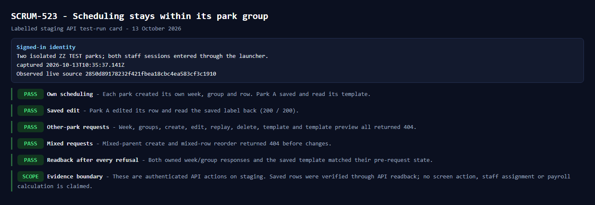

# Scheduling park group acceptance

13 October 2026. SCRUM-523 under SCRUM-191.

## Release and hosted checks

Main `2850d89178232f421fbea18cbc4ea583cf3c1910` passed all six jobs in [run 38374525197](https://github.com/vickyydev/oto-platform/actions/runs/38374525197). API 4,033 passed; scheduling 32/32; feature runtime 89/89; Console browser 30. Workspace and API compiler output is clean. The app retains 442 diagnostics across 59 files and 118 buckets, without an increase; the existing 457 ceiling remains. Build and hosted restore/replay passed. No migration was added.

All six services were observed live on this exact source at 17:29 Bangkok. The app deployment was explicitly started after no automatic deployment was queued and completed at 16:37 Bangkok.

## Staging results

Two administrator sessions entered through the launcher. Isolated ZZ TEST branches contained no employees. Between 17:29:32 and 17:29:39 Bangkok:

- Each park created its own week, group and row. Park A saved and read its own template.
- Park A edited a row and read the saved label back, both HTTP 200.
- Eight other-park requests for week, groups, create, edit, replay, delete, template and template preview returned 404.
- Mixed-parent creation and mixed-row reordering returned 404.
- After every refusal, both owned week/group responses and the saved template matched their prior state.

This is authenticated API evidence. The isolated branch is not listed in the platform-backed branch selector, so no saved-row screen or UI-action proof is claimed. No staff assignment or payroll calculation was performed. Existing choices between branches in one park and shared role definitions remain the default.

## Exact temporary record cleanup

Preview job-db70jnl9fdbs73ekmf70 selected exactly 13 rows and one session, checking 328 foreign-key columns and 1,563 additional reference columns. Apply job-db70ka4s728c73d239u0 matched that preview fingerprint and committed all exact removals, verified absence and retained the seeded account, employee, operator, branch, administrator assignment and existing park.

Supported unlink returned 200 and cleared the platform account stamp. The existing active app session still returned 200 until exact temporary-user/session removal; final `/api/user` returned 401. This access-lifecycle observation is recorded under the existing SCRUM-288 item, without changing its priority or approved offboarding behavior.

The manifest comprised two weeks, two groups, two rows, one template, one template row, one branch-access record, one new app user, two branches and one new park. No employee, message or provider credential was created. This is separate from the earlier lift cleanup counts.

## Jira and checkpoint

SCRUM-523 and parent SCRUM-191 are Done; all twelve child tickets are Done. Eleven linked lift deliveries remain Deployed with inspected images. The card above was inspected and attached to SCRUM-523 (attachment 11433) and SCRUM-191. Documentation checkpoint `87d4727c` has no CI run because the workflow excludes documentation; its watcher was stopped after exact-SHA readback returned no runs. The application release remains the fully green source recorded above.
